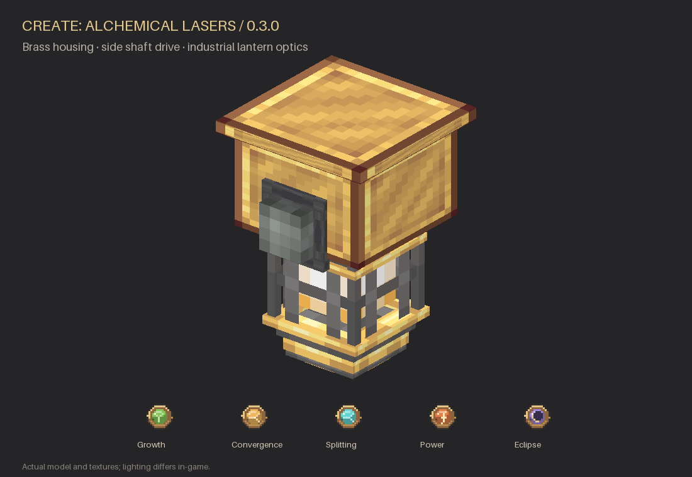

Kinetic laser processing for **Minecraft 1.21.1 • NeoForge • Create 6.0.10**.

A single emitter bulk-processes items on Mechanical Belts, Depots and the ground. A caged industrial optical head hangs below a solid brass housing, powered through its horizontal side shaft. Five reusable lenses select recipes and color a native beacon beam. Includes pixel-art optical cartridges, spatial audio and Create Ponder tutorials.

## How it works

1. Place an emitter above a horizontal belt or Depot, leaving one air block between them, like a Mechanical Press.
2. Connect rotational power to either exposed end of the horizontal shaft and supply at least 16 RPM. Use a wrench to align the emitter with your shaft line.
3. Right-click with any optical lens. Sneak-right-click with an empty hand to remove it.
4. Supply a matching item. The laser holds it during charging and processing, commits the transformation, then releases the output.

Speed scales processing time, up to the configured cap. A powered redstone signal disables the emitter. Interrupted cycles leave input unchanged; belt items are released, and Depots can restart when power returns.

## Features

- Bulk processing on belts and Depots, plus multiple dropped item stacks directly beneath the beam. Complete recipe quantities process together; incomplete remainders stay behind.
- Five reusable lenses with fitted 3D cartridges, animated Minecraft beacon beams, charging particles and completion effects.
- Industrial lantern adapted from Create Deco with permission, paired with a brass housing using Create’s brass texture; see [credits](THIRD_PARTY_NOTICES.md).
- Seven original sound events, including a spatial beam loop that stops when processing stops or the machine unloads.
- Engineer's Goggles information, Create wrench interaction and a one-slot lens item capability for automation.
- Datapack recipes and generic KubeJS custom recipes; optional component copying and probabilistic secondary outputs.
- Optional JEI and EMI recipe categories showing the lens, input, outputs, duration and minimum RPM.
- Six Ponder scenes: setup, kinetic power, belt processing, lens changes, sequential automation and redstone.

## Starter recipes

| Lens | Input | Output |
|---|---|---|
| Power | Sand | Glass |
| Power | Clay ball | Brick |
| Convergence | Magma block | Obsidian |
| Splitting | Amethyst shard | Quartz |
| Eclipse | Quartz | Prismarine crystals |
| Growth | Wheat seeds | Wheat |
| Convergence | 4 amethyst shards | Amethyst block |
| Splitting | Amethyst block | 4 amethyst shards |
| Power | Obsidian | Crying obsidian |
| Eclipse | Sculk | Echo shard |

These are standalone examples. Modpacks can replace them with their own progression. Towns & Kingdoms is not required.

[Custom recipes and KubeJS](docs/RECIPES.md) · [Development specification](docs/DEVELOPMENT_PLAN.md)

## Requirements

Minecraft 1.21.1, Java 21, NeoForge 21.1.219 or newer, and Create 6.0.10 (6.0.x). Use Create's required matching dependencies. JEI, EMI and KubeJS are optional.

Current release: **0.3.0**. See [release notes](CHANGELOG.md) for the verification status and remaining manual checks.

The specialist lenses are recipe selectors. Their starter recipes demonstrate growth, consolidation, splitting, energizing and sculk processing; datapacks and KubeJS can replace them. The obsidian Power recipe requires 64 RPM and the Eclipse example requires 128 RPM.

**Updating from 0.2.0 or 0.2.1:** connect power to either horizontal shaft end. The top no longer accepts a shaft or large cog drive. Belt/Depot height and the lantern position stay the same; the five named lenses retain their item IDs.

**Updating to 0.3.0:** Red, Blue, Purple and White lenses have been removed. Replace them with Power, Convergence, Splitting and Eclipse respectively; the earlier starter transformations now use those lenses. Removed lens items cannot be recovered after loading an old world.
